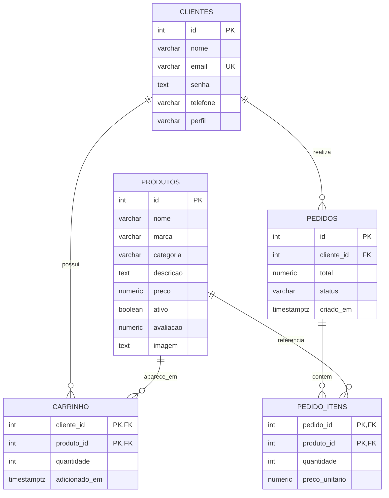
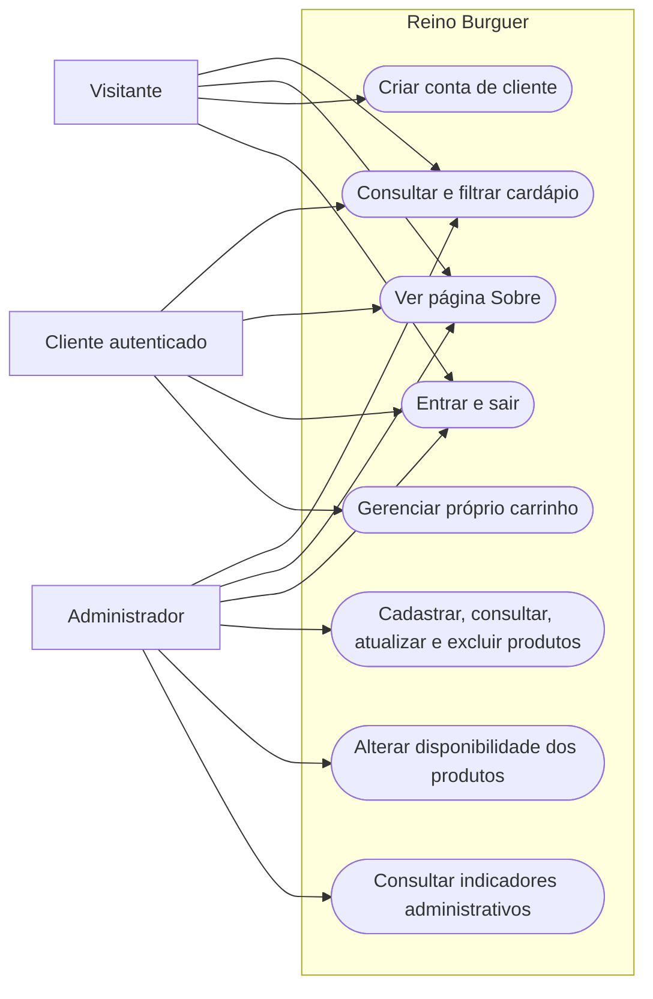

# Reino Burguer — Sistema de Cardápio e Gestão

O **Reino Burguer** é uma aplicação web para apresentar o cardápio de uma hamburgueria cristã e administrar seus produtos. Visitantes podem consultar e filtrar os itens; clientes podem criar uma conta e utilizar um carrinho; administradores podem manter o catálogo e consultar indicadores.

Este documento descreve o que está implementado no projeto. A estrutura das seções de especificação foi adaptada do arquivo de referência `inspo.md`; funcionalidades que aparecem nele, mas não existem neste sistema, não são apresentadas como implementadas.

---

## Como Executar o Projeto Localmente

### Pré-requisitos

- **PHP** compatível com o código do projeto e com a extensão `pdo_pgsql` habilitada.
- **PostgreSQL** instalado e em execução.
- Navegador web moderno.
- Opcional: **Git**, caso o projeto seja obtido de um repositório.

### Passo 1: Clonar o repositório

Com o Git instalado, abra um terminal na pasta em que deseja salvar o projeto e execute:

```bash
git clone https://github.com/gabihub16/reino.git
cd reino
```

Se estiver clonando um fork ou outro repositório, substitua a URL pela fornecida pelo responsável. Os próximos comandos devem ser executados na pasta raiz do projeto, onde estão `index.php` e as pastas `app/`, `database/` e `includes/`.

### Compactar a pasta clonada em ZIP (Windows)

Depois de clonar o projeto, volte para a pasta que contém a pasta `reino`. No Explorador de Arquivos, clique com o botão direito na pasta `reino` e selecione **Compactar para arquivo ZIP** (ou **Enviar para > Pasta compactada**, dependendo da versão do Windows). Será criado um arquivo `reino.zip` nessa pasta.

Também é possível criar o ZIP pelo PowerShell, estando na pasta que contém `reino`:

```powershell
Compress-Archive -Path .\reino -DestinationPath .\reino.zip
```

Antes de compartilhar o arquivo, confira se ele não contém senhas, credenciais ou dumps com dados pessoais.

### Publicar o projeto no servidor pelo MobaXterm

1. Compacte a pasta clonada em `reino.zip`, conforme a etapa anterior.
2. No MobaXterm, crie uma sessão **SSH** com o endereço, a porta e o usuário fornecidos pelo responsável pelo servidor. Conecte-se usando a forma de autenticação fornecida.
3. No painel SFTP à esquerda, abra a pasta do site indicada pelo responsável pelo servidor. O nome e o caminho dessa pasta variam conforme a hospedagem.
4. Envie `reino.zip` para essa pasta. Se preferir, envie os arquivos da pasta `reino` já extraídos.
5. Se enviou o ZIP, no terminal SSH entre na pasta do site e extraia os arquivos:

   ```bash
   cd /caminho/da/pasta-do-site
   unzip reino.zip
   ```

   Se não houver `unzip` no servidor, extraia o arquivo no computador e envie os arquivos pelo painel SFTP.

6. Confira no painel SFTP se `index.php` está na pasta pública do site. Se os arquivos ficaram dentro de uma subpasta `reino`, o responsável pelo servidor deve configurar o site para apontar para essa pasta ou orientar onde colocar os arquivos.
7. Configure `database/connect.php` com os dados do banco de produção fornecidos pelo responsável pelo servidor. Não compartilhe esses dados nem os inclua no repositório.
8. Abra no navegador o endereço do site fornecido pelo responsável. Se o banco ainda não estiver preparado, peça ao responsável para criar/preparar o banco antes de acessar o sistema.

### Passo 2: Criar e preparar o banco de dados

1. No PostgreSQL, crie um banco vazio, por exemplo `reino_burguer`.
2. Execute o script `database/cardapio.sql` nesse banco. Ele cria as tabelas e insere os produtos iniciais sem duplicar os que já existem na mesma categoria.

É possível executar o script pelo pgAdmin ou por uma ferramenta de linha de comando do PostgreSQL. Não apague um banco existente sem antes confirmar que há uma cópia de segurança.

### Passo 3: Configurar a conexão

Abra `database/connect.php` e substitua os valores de exemplo pelas informações do seu PostgreSQL:

```php
$host = 'localhost';
$dbname = 'reino_burguer';
$user = 'seu_usuario';
$pass = 'sua_senha';
```

### Passo 4: Iniciar o servidor PHP

No terminal, ainda na raiz do projeto, inicie o servidor embutido do PHP:

```text
php -S localhost:8000
```

Abra `http://localhost:8000` no navegador. Para encerrar o servidor, volte ao terminal e pressione `Ctrl+C`.

### Passo 5: Criar uma conta e entrar

1. No endereço em que deseja usar o sistema, acesse a opção de cadastro e crie uma conta. Os novos cadastros recebem o perfil `cliente`. Uma conta criada em `localhost` fica no banco local e não é transferida para o servidor; para usar o site publicado, cadastre-se novamente nele.
2. Entre como cliente usando o e-mail e a senha cadastrados.
3. O banco de dados usado pelo projeto já possui um usuário com perfil de administrador criado. O e-mail de acesso é `jorgeadm@gmail.com`.

> **Atenção:** se você criar um banco do zero executando apenas `database/cardapio.sql`, o script cria a estrutura e os produtos do cardápio, mas não insere a conta administrativa. Nesse caso, a conta de administrador precisa ser cadastrada/preparada separadamente no banco.

As senhas criadas pelo formulário de cadastro são armazenadas com `password_hash()`. Nunca utilize ou compartilhe uma senha de produção em documentação pública.

---

## Especificação de Requisitos do Sistema

Esta especificação descreve as funcionalidades e características observáveis no código e no banco de dados atuais do Reino Burguer. Ela segue uma organização inspirada em documentos de requisitos, mas não declara certificação ou conformidade formal com uma norma.

## 1. Introdução

### 1.1 Escopo do sistema

O sistema apresenta e administra um cardápio online. Ele oferece páginas para visitantes, clientes autenticados e administradores. Visitantes e administradores podem pesquisar o catálogo por nome ou descrição e filtrar por categoria; clientes autenticados veem o cardápio completo, sem controles de pesquisa e filtro. Clientes podem adicionar produtos disponíveis ao próprio carrinho, consultar quantidades e valores e remover itens. Administradores podem cadastrar, listar, consultar, atualizar e excluir produtos, além de visualizar indicadores.

O projeto não possui fluxo de checkout, pagamento ou finalização de compra. As tabelas de pedidos existem para suportar os indicadores do painel, mas os pedidos não são criados pelas telas atuais.

### 1.2 Propósito

O propósito é centralizar a apresentação do cardápio e oferecer ferramentas básicas para o gerenciamento do catálogo, de contas de clientes e do carrinho, utilizando PHP e PostgreSQL.

## 2. Descrição Global

### 2.1 Visão geral

O projeto é uma aplicação web renderizada pelo PHP. As páginas compartilham funções, conexão com o banco, configuração de URLs, cabeçalho, rodapé e folhas de estilo. O acesso às páginas administrativas e às operações do carrinho é controlado pelo perfil armazenado na sessão.

### 2.2 Funções do sistema

- Exibir os produtos e permitir que visitantes e administradores busquem por nome ou descrição e filtrem por categoria.
- Cadastrar clientes, autenticar usuários e encerrar a sessão.
- Adicionar produtos disponíveis ao carrinho do cliente autenticado.
- Aumentar a quantidade quando o mesmo produto for adicionado novamente.
- Exibir itens, quantidades, preços, subtotais e total do carrinho.
- Remover produtos do carrinho.
- Permitir que administradores cadastrem, consultem, listem, atualizem e excluam produtos.
- Permitir que administradores indiquem se um produto está disponível ou inativo.
- Exibir no painel administrativo a quantidade de clientes, os pedidos não cancelados do mês e a renda mensal calculada a partir dos pedidos registrados.
- Apresentar uma página institucional Sobre.

### 2.3 Características dos usuários

| Usuário | Descrição |
| :--- | :--- |
| **Visitante** | Pessoa sem sessão autenticada. Pode consultar e filtrar o cardápio, acessar a página Sobre, cadastrar-se ou entrar. Para comprar, deve autenticar-se como cliente. |
| **Cliente** | Usuário autenticado com perfil `cliente`. Pode consultar o cardápio completo sem pesquisa ou filtros, adicionar produtos disponíveis ao carrinho, consultar o carrinho e remover itens. |
| **Administrador** | Usuário autenticado com perfil `admin`. Pode acessar as páginas de gerenciamento de produtos e visualizar o dashboard administrativo. |

---

## 3. Requisitos do Sistema

### 3.1 Requisitos funcionais

#### Módulo de acesso e contas

| ID | Título | Descrição | Prioridade |
| :--- | :--- | :--- | :--- |
| **RF01** | Cadastro de cliente | O sistema deve permitir o cadastro de nome, e-mail, telefone e senha para uma conta de cliente. | Alta |
| **RF02** | Autenticação | O sistema deve validar as credenciais e iniciar uma sessão com o perfil correspondente. | Alta |
| **RF03** | Encerramento de sessão | O sistema deve permitir que o usuário encerre a sessão autenticada. | Alta |
| **RF04** | Controle por perfil | O sistema deve restringir páginas administrativas a administradores e operações do carrinho a clientes autenticados. | Alta |

#### Módulo de cardápio e produtos

| ID | Título | Descrição | Prioridade |
| :--- | :--- | :--- | :--- |
| **RF05** | Exibição do cardápio | O sistema deve apresentar os produtos cadastrados, com categoria, descrição e preço. | Alta |
| **RF06** | Busca e filtro | O sistema deve permitir que visitantes e administradores busquem produtos por nome ou descrição e filtrem por categoria. | Alta |
| **RF07** | Cadastro de produto | O administrador deve poder cadastrar nome, marca, categoria, descrição, preço e disponibilidade. | Alta |
| **RF08** | Consulta e listagem | O administrador deve poder listar os produtos e consultar um produto pelo ID. | Alta |
| **RF09** | Atualização de produto | O administrador deve poder atualizar os dados e a disponibilidade de um produto. | Alta |
| **RF10** | Exclusão de produto | O administrador deve poder solicitar a exclusão de um produto pelo ID. | Alta |

#### Módulo de carrinho

| ID | Título | Descrição | Prioridade |
| :--- | :--- | :--- | :--- |
| **RF11** | Adição ao carrinho | O cliente autenticado deve poder adicionar ao carrinho um produto marcado como disponível. | Alta |
| **RF12** | Quantidade de itens | Ao adicionar novamente o mesmo produto, o sistema deve incrementar a quantidade existente. | Média |
| **RF13** | Consulta do carrinho | O cliente deve poder consultar os produtos, quantidades, preços, subtotais e total do próprio carrinho. | Alta |
| **RF14** | Remoção do carrinho | O cliente deve poder remover um produto do próprio carrinho. | Alta |

#### Módulo de indicadores

| ID | Título | Descrição | Prioridade |
| :--- | :--- | :--- | :--- |
| **RF15** | Dashboard administrativo | O sistema deve apresentar a contagem de clientes, pedidos não cancelados no mês e renda mensal registrada em pedidos. | Média |

> **Limite atual:** não há funcionalidade para finalizar compras ou criar pedidos pela interface. Portanto, os indicadores de pedidos e renda dependem de registros inseridos no banco por outro meio.

### 3.2 Requisitos não funcionais

| ID | Título | Descrição | Prioridade |
| :--- | :--- | :--- | :--- |
| **RNF01** | Tecnologias | A aplicação utiliza PHP, PostgreSQL, PDO, HTML e CSS. | Alta |
| **RNF02** | Persistência de dados | As consultas e alterações são realizadas por meio de conexão PDO com o PostgreSQL. | Alta |
| **RNF03** | Senhas de cadastro | As senhas de novos clientes devem ser armazenadas com hash usando `password_hash()`. | Alta |
| **RNF04** | Interface responsiva | A interface deve adaptar o catálogo e os componentes a diferentes larguras de tela por meio de CSS responsivo. | Média |
| **RNF05** | Apresentação segura de dados | Valores textuais exibidos em partes do sistema são escapados com `htmlspecialchars()` para evitar que sejam interpretados como marcação HTML. | Alta |
| **RNF06** | Feedback | O sistema deve apresentar mensagens de sucesso, erro ou ausência de resultados em operações relevantes. | Média |

### 3.3 Regras de negócio implementadas

| ID | Regra |
| :--- | :--- |
| **RN01** | Novos cadastros são criados com perfil `cliente`; o formulário de cadastro não permite criar um administrador. |
| **RN02** | Somente sessões com perfil `admin` podem acessar as páginas administrativas protegidas. |
| **RN03** | Somente clientes autenticados podem acessar as páginas e ações do carrinho. |
| **RN04** | Apenas produtos das categorias reconhecidas são aceitos pela função de cadastro de produtos. |
| **RN05** | Produtos inativos ou inexistentes não podem ser adicionados ao carrinho. |
| **RN06** | Um cliente possui no máximo uma linha por produto no carrinho; novas adições incrementam a quantidade. |
| **RN07** | A quantidade no carrinho deve ser positiva, conforme restrição do banco de dados. |
| **RN08** | A exclusão de uma conta remove seus itens do carrinho; a exclusão de um produto também remove sua associação no carrinho, conforme as chaves estrangeiras. |
| **RN09** | Produtos referenciados por itens de pedido não podem ser excluídos devido à restrição da chave estrangeira `pedido_itens.produto_id`. |
| **RN10** | Os indicadores mensais ignoram pedidos com status `cancelado` e consideram registros a partir do início do mês atual. |

---

## 4. Estrutura do Banco de Dados

O banco PostgreSQL contém cinco tabelas principais, definidas em `database/cardapio.sql`. As tabelas de pedido estão preparadas no esquema, embora o sistema não tenha um fluxo de compra que as preencha.

#### Entidade: `produtos`

Armazena os itens exibidos e administrados no cardápio.

| Campo | Tipo | Restrições | Descrição |
| :--- | :--- | :--- | :--- |
| `id` | INTEGER | Chave primária, identidade | Identificador do produto. |
| `nome` | VARCHAR(150) | Não nulo | Nome exibido no cardápio. |
| `marca` | VARCHAR(100) | Não nulo | Marca ou estabelecimento associado. |
| `categoria` | VARCHAR(50) | Não nulo | Categoria do item. |
| `descricao` | TEXT | Não nulo | Descrição do produto. |
| `preco` | NUMERIC(10,2) | Não nulo, maior ou igual a zero | Preço do produto. |
| `ativo` | BOOLEAN | Não nulo, padrão `TRUE` | Indica se o produto pode ser adicionado ao carrinho. |
| `avaliacao` | NUMERIC(2,1) | Opcional, entre 0 e 5 | Campo previsto para avaliação. |
| `imagem` | TEXT | Opcional | Campo para nome ou caminho de imagem; não há formulário de upload implementado. |

#### Entidade: `clientes`

Armazena contas de clientes e administradores.

| Campo | Tipo | Restrições | Descrição |
| :--- | :--- | :--- | :--- |
| `id` | INTEGER | Chave primária, identidade | Identificador da conta. |
| `nome` | VARCHAR(150) | Não nulo | Nome do usuário. |
| `email` | VARCHAR(255) | Não nulo, único | E-mail usado para localizar a conta. |
| `senha` | TEXT | Não nulo | Senha armazenada; novos cadastros recebem hash. |
| `telefone` | VARCHAR(20) | Não nulo | Telefone de contato. |
| `perfil` | VARCHAR(20) | `cliente` ou `admin`; padrão `cliente` | Define as permissões da conta. |

#### Entidade: `carrinho`

Relaciona clientes a produtos e armazena as quantidades escolhidas.

| Campo | Tipo | Restrições | Descrição |
| :--- | :--- | :--- | :--- |
| `cliente_id` | INTEGER | Chave estrangeira; parte da chave primária | Conta proprietária do item. |
| `produto_id` | INTEGER | Chave estrangeira; parte da chave primária | Produto adicionado. |
| `quantidade` | INTEGER | Não nulo, maior que zero, padrão `1` | Quantidade do produto. |
| `adicionado_em` | TIMESTAMPTZ | Não nulo, padrão horário atual | Data e hora de inclusão. |

#### Entidade: `pedidos`

Armazena o total, o status, o cliente e a data de cada pedido registrado.

| Campo | Tipo | Restrições | Descrição |
| :--- | :--- | :--- | :--- |
| `id` | INTEGER | Chave primária, identidade | Identificador do pedido. |
| `cliente_id` | INTEGER | Chave estrangeira, exclusão restrita | Cliente associado ao pedido. |
| `total` | NUMERIC(10,2) | Não nulo, maior ou igual a zero | Valor total registrado. |
| `status` | VARCHAR(20) | `pendente`, `finalizado` ou `cancelado` | Situação do pedido; padrão `finalizado`. |
| `criado_em` | TIMESTAMPTZ | Não nulo, padrão horário atual | Data e hora de criação. |

#### Entidade: `pedido_itens`

Armazena os produtos e os valores unitários associados a cada pedido.

| Campo | Tipo | Restrições | Descrição |
| :--- | :--- | :--- | :--- |
| `pedido_id` | INTEGER | Chave estrangeira; parte da chave primária | Pedido ao qual o item pertence. |
| `produto_id` | INTEGER | Chave estrangeira com exclusão restrita; parte da chave primária | Produto do item. |
| `quantidade` | INTEGER | Não nulo, maior que zero | Quantidade comprada. |
| `preco_unitario` | NUMERIC(10,2) | Não nulo, maior ou igual a zero | Preço unitário registrado no pedido. |

---

## 5. Diagramas

### 5.1 Diagrama Entidade-Relacionamento

O diagrama representa as tabelas e as relações implementadas no esquema SQL.



### 5.2 Diagrama de casos de uso

O diagrama resume as ações disponíveis para visitantes, clientes e administradores.



---

## 6. Organização do Projeto

```text
reino/
├── index.php
├── app/
│   ├── create.php            # Cadastro de produto
│   ├── delete.php            # Exclusão de produto
│   ├── informacoes.php       # Página institucional Sobre
│   ├── select.php            # Listagem do cardápio para o administrador
│   ├── select_where.php      # Consulta de produto pelo ID
│   └── update.php            # Atualização de produto
├── assets/
│   ├── reino-burguer-favicon.png
│   ├── reino-burguer-fundo.png
│   └── reino-burguer-logo.png
├── css/
│   ├── alertas.css           # Mensagens de feedback
│   ├── botoes.css            # Botões e estados
│   ├── cartoes.css           # Catálogo e cartões de produtos
│   ├── componentes.css       # Filtros, rodapé e componentes compartilhados
│   ├── dash.css              # Indicadores administrativos
│   ├── forms.css             # Formulários
│   ├── global.css            # Estilos globais e tipografia
│   ├── inform.css            # Página Sobre
│   ├── nav.css               # Cabeçalhos e navegação
│   ├── resetar.css           # Normalização dos estilos do navegador
│   ├── responsive.css        # Ajustes para diferentes tamanhos de tela
│   ├── style.css             # Ponto de entrada das folhas de estilo
│   ├── tabelas.css           # Tabelas e rolagem responsiva
│   ├── telalogin.css         # Telas de login e cadastro
│   └── variaveis.css         # Cores, fontes, espaçamentos e outros tokens
├── database/
│   ├── cardapio.sql          # Tabelas e produtos iniciais
│   └── connect.php           # Conexão PDO com o PostgreSQL
├── includes/
│   ├── configuracao.php      # Montagem da raiz e das URLs
│   ├── footer.php            # Rodapé compartilhado
│   ├── functions.php         # Funções de produtos, clientes, painel e carrinho
│   └── header.php            # Navegação administrativa compartilhada
├── login/
│   ├── cadastrar.php         # Cadastro de cliente
│   ├── login.php             # Autenticação
│   ├── logout.php            # Encerramento da sessão
│   ├── verficacli.php        # Proteção de páginas de cliente
│   └── verificadm.php        # Proteção de páginas administrativas
├── mpedidos/
│   ├── acrescentar.php       # Adição de item ao carrinho
│   ├── carrinho.php          # Visualização do carrinho
│   └── excluir.php           # Remoção de item do carrinho
├── apresentacao.md           # Texto e roteiro para apresentação
├── inspo.md                  # Documento de referência estrutural
└── README.md                 # Documentação principal do projeto
```

### Arquivos principais

- `index.php`: página inicial, filtros do catálogo e dashboard para administradores.
- `app/create.php`, `app/select.php`, `app/select_where.php`, `app/update.php` e `app/delete.php`: operações administrativas de produtos.
- `app/informacoes.php`: página institucional Sobre.
- `includes/functions.php`: funções de acesso a produtos, clientes, painel e carrinho.
- `includes/configuracao.php`: detecção da raiz pública e montagem de URLs.
- `database/connect.php`: conexão PDO com o PostgreSQL.
- `database/cardapio.sql`: estrutura das tabelas e carga inicial do cardápio.
- `css/style.css`: ponto de entrada que importa as demais folhas de estilo.

---

## 7. Limitações Conhecidas

- Não existe fluxo de finalização de compra, pagamento ou gravação de pedidos pela interface.
- O painel administrativo só mostrará valores de pedidos e renda se houver registros na tabela `pedidos`.
- O banco prevê o campo `imagem` para produtos, mas o formulário atual não oferece upload nem exibição de imagens do catálogo.
- O cadastro público cria contas de cliente. Uma conta administrativa precisa ser preparada localmente por uma pessoa autorizada.
- O banco deve ser configurado em `database/connect.php` antes de iniciar o sistema.
